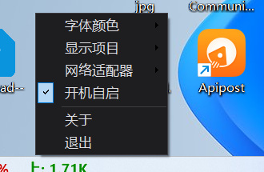
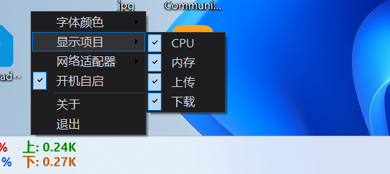
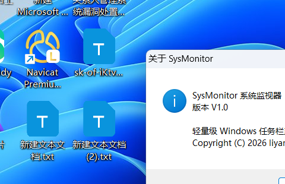

# SysMonitor 系统监视器 软件说明书

版本：V1.0
著作权人：liyang
编写日期：2026 年

---

## 一、软件概述

### 1.1 软件名称与版本

- 软件全称：SysMonitor 系统监视器
- 软件简称：SysMonitor
- 版本号：V1.0
- 编程语言：C#（.NET Framework 4.x）
- 源程序量：约 722 行（单一源文件 SysMonitor.cs，含注释）
- 程序形式：Windows 桌面应用程序（WinForms，单文件可执行）

### 1.2 开发目的

Windows 系统自带的任务管理器需要主动打开、占用桌面空间，用户难以在日常工作中随时掌握 CPU、内存与网络的使用状况。本软件旨在提供一款常驻任务栏、体积小巧、无需安装的轻量级系统资源监视工具，让用户在不占用桌面空间的前提下，随时查看关键系统指标。

### 1.3 软件特点

- 直接嵌入 Windows 任务栏，与任务栏融为一体，不占用桌面空间
- 单个可执行文件，体积约 18KB，无需安装、无需 SDK 或第三方依赖
- 仅依赖 Windows 系统自带的 .NET Framework 4.x 运行时
- 支持 Windows 7 / 8 / 8.1 / 10 / 11
- 支持开机自启动、单实例运行

### 1.4 运行环境

| 项目 | 要求 |
|------|------|
| 操作系统 | Windows 7 SP1 / 8 / 8.1 / 10 / 11（x86、x64） |
| 运行库 | .NET Framework 4.x（Windows 系统自带） |
| 硬件 | 无特殊要求，任意可运行上述系统的 PC |
| 安装 | 绿色免安装，直接运行 SysMonitor.exe |

---

## 二、功能说明

本软件提供以下功能：

1. **CPU 使用率监视**：实时显示处理器总使用率（百分比）。
2. **内存使用率监视**：实时显示物理内存已使用百分比，并基于物理内存总量换算。
3. **网络速度监视**：实时显示所有活动网卡（或指定网卡）的上传、下载速度，自动换算 K/M 单位。
4. **任务栏嵌入**：窗口主体嵌入系统任务栏（Shell_TrayWnd），随任务栏显示。
5. **透明背景**：使用透明键（TransparencyKey）令背景与任务栏一致，仅显示文字。
6. **显示项目开关**：用户可自由勾选需要显示的 CPU、内存、上传、下载四个项目，界面布局自动收缩。
7. **网络适配器选择**：多网卡环境下，用户可指定监视的网卡，或选择“全部网络”累加所有活动网卡。
8. **字体颜色方案**：提供彩色、黑色、蓝色、红色四种配色方案。
9. **配置记忆**：配色方案、显示项目、网络适配器选择自动保存至注册表，程序重启后自动恢复。
10. **开机自启动**：可将本程序写入当前用户启动项，实现开机自动运行。
11. **单实例运行**：通过互斥体（Mutex）保证同一时间只运行一个实例。
12. **多屏/分辨率自适应**：监听显示设置变化事件，在分辨率或任务栏高度变化时自动重新布局。
13. **菜单外部点击自动关闭**：菜单打开期间由看门狗定时器监视鼠标按键，光标在菜单（含子菜单）之外发生点击时立即关闭菜单，保证任务栏嵌入场景下菜单行为与常规应用一致。

---

## 三、安装与启动

1. 从发布页面下载 `SysMonitor.exe`。
2. 双击运行，程序会自动嵌入任务栏左侧。
3. 无需安装，无需配置，关闭程序可在右键菜单选择“退出”。
4. 如需开机自启，在右键菜单勾选“开机自启”。

---

## 四、操作说明

### 4.1 主界面

程序启动后，在任务栏左侧显示一块文字区域，默认包含四个指标（每行两个）：

- 第一行左侧：`C: xx%`（CPU 使用率）
- 第二行左侧：`M: xx%`（内存使用率）
- 第一行右侧：`上: x.xxK`（上传速度）
- 第二行右侧：`下: x.xxK`（下载速度）

数据每秒刷新一次。

### 4.2 右键菜单

在任务栏文字区域点击右键，弹出暗色主题菜单，包含：

| 菜单项 | 说明 |
|--------|------|
| 字体颜色 | 子菜单，可选“彩色 / 黑色 / 蓝色 / 红色”四种配色 |
| 显示项目 | 子菜单，可勾选“CPU / 内存 / 上传 / 下载”，取消勾选即隐藏对应项 |
| 网络适配器 | 子菜单，可选“全部网络”或具体网卡 |
| 开机自启 | 勾选后写入当前用户启动项，取消勾选则移除 |
| 关于 | 显示软件名称、版本号与版权信息 |
| 退出 | 关闭程序 |

### 4.3 配置保存说明

配色、显示项目、网络适配器选择会写入注册表：

```
HKEY_CURRENT_USER\Software\SysMonitor
```

---

## 五、运行截图

以下截图在 Windows 11（1920×1080）环境实际运行截取：

### 5.1 主界面（嵌入任务栏）

程序启动后嵌入任务栏左侧，以透明背景显示四项指标，不占用桌面空间：


### 5.2 右键菜单

在任务栏文字区域点击右键，弹出暗色主题菜单：



### 5.3 显示项目子菜单

可自由勾选需要显示的指标，取消勾选后界面自动收缩：



### 5.4 关于对话框

显示软件名称、版本号与版权信息：



---

## 六、技术实现说明

本软件为单一 C# 源文件实现，主要技术要点如下：

1. **性能数据采集**：使用 `System.Diagnostics.PerformanceCounter` 读取 `Processor / % Processor Time / _Total`（CPU）与 `Memory / Available MBytes`（可用内存），并通过 `GlobalMemoryStatusEx`（kernel32.dll）获取物理内存总量换算使用率。
2. **网络速度采集**：通过 `NetworkInterface.GetAllNetworkInterfaces()` 读取各活动网卡的 IPv4 收发字节数，按采集间隔计算实时速率。
3. **任务栏嵌入**：通过 `FindWindow("Shell_TrayWnd", null)` 定位任务栏窗口，使用 `SetParent` 将本窗口设为任务栏子窗口，再用 `SetWindowPos` 设置位置与尺寸。
4. **透明背景**：设置 `TransparencyKey` 为背景色，使窗口背景透明，仅保留抗锯齿绘制的文字。
5. **自绘界面**：重写 `OnPaint`，按当前显示项目动态计算列宽、列坐标并绘制文本。
6. **暗色右键菜单**：继承 `ToolStripProfessionalRenderer` 并自定义 `ProfessionalColorTable` 实现暗色主题。
7. **配置持久化**：使用 `Microsoft.Win32.Registry` 读写当前用户注册表项。
8. **单实例**：使用命名 `Mutex` 判断并阻止重复运行。
9. **高 DPI 适配**：调用 `SetProcessDPIAware` 使界面在高分屏下清晰。
10. **菜单看门狗机制**：针对任务栏嵌入窗口无法获得前台、右键菜单不能自动关闭的问题，采用 50ms 定时器轮询鼠标按键状态（`GetAsyncKeyState`）与光标位置（`GetCursorPos`），实现在菜单外部点击即关闭菜单。

---

## 七、版本历史

| 版本 | 日期 | 说明 |
|------|------|------|
| V1.0 | 2026 | 首个版本：CPU / 内存 / 网络监视、任务栏嵌入、透明背景、配色、显示项开关、网卡选择、配置记忆、开机自启、关于信息、菜单外部点击自动关闭 |

---

（说明书完）
